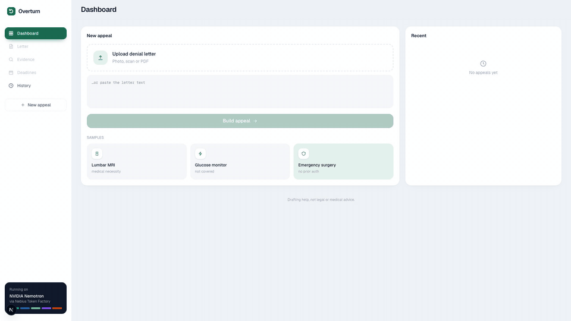
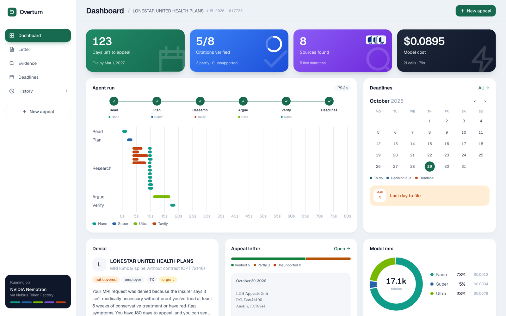
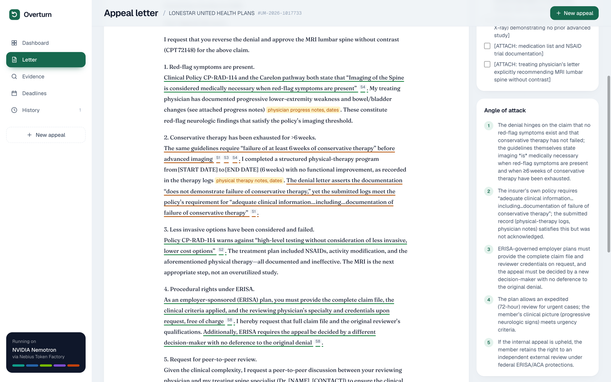
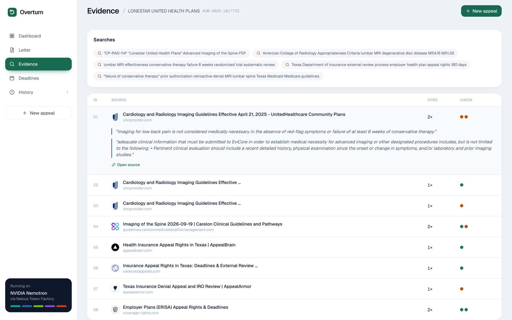
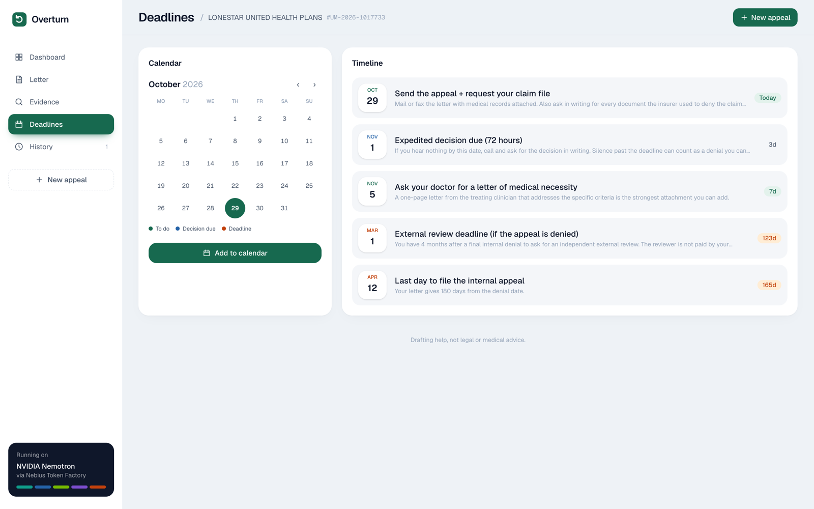
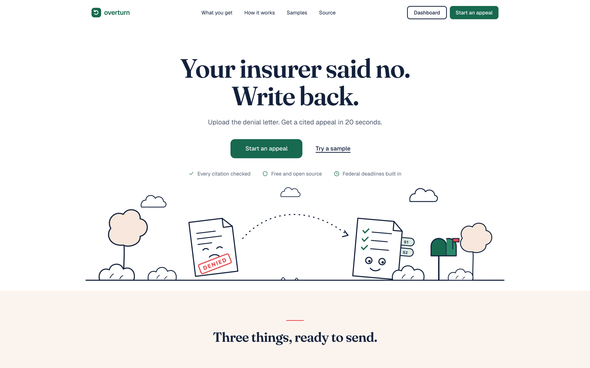
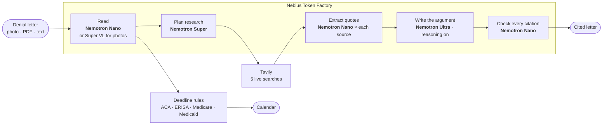

<a id="top"></a>

<div align="center">


# Overturn

**Your insurer said no. Write back.**

Upload a health-insurance denial letter. Get a cited appeal letter, the evidence behind it, and every deadline on your calendar.

[](https://overturn-eight.vercel.app)
[](LICENSE)


[Live app](https://overturn-eight.vercel.app/app) ·
[Try a sample](https://overturn-eight.vercel.app/app?sample=er) ·
[How it works](#how-it-works) ·
[Run it locally](#getting-started) ·
[Feedback](#feedback-on-nebius-token-factory-and-nvidia-models)

<br />



<sub>A real run on the emergency-surgery sample. Every bar is one model call, colored by model.</sub>

</div>

---

Built for the **Nebius × NVIDIA Global AI Hackathon**, Best Apps and Agents track.

## Table of contents

- [The problem](#the-problem)
- [What you get](#what-you-get)
- [How it works](#how-it-works)
- [Nemotron on Token Factory](#nemotron-on-token-factory)
- [Measured results](#measured-results)
- [Getting started](#getting-started)
- [Project structure](#project-structure)
- [Deploy](#deploy)
- [Limits](#limits)
- [Feedback on Nebius Token Factory and NVIDIA models](#feedback-on-nebius-token-factory-and-nvidia-models)
- [License](#license)

## The problem

| 📄 Insurers say no | 🧭 Appeals are hard | ⏳ The clock is running |
|---|---|---|
| US insurers deny a large share of in-network claims (see KFF's analyses of ACA marketplace data). | An appeal means reading the plan's clinical policy, the medical guideline and federal rules, then writing a formal letter. | Most plans give 180 days to file. Miss it and the denial stands. Very few people ever appeal, even though many appeals succeed. |

Overturn does the reading, the research and the first draft. You review it and send it.

<p align="right"><a href="#top">↑ back to top</a></p>

## What you get

<table>
<tr>
<td width="50%" valign="top">

**Dashboard.** Days left to appeal, citations verified, sources found and model cost, plus every model call on a timeline as the agent works.


</td>
<td width="50%" valign="top">

**Appeal letter.** Answers the insurer's exact reason, point by point. Cited sentences are underlined green (verified) or amber (partly supported). Facts only you know are left as highlighted blanks, never guessed.


</td>
</tr>
<tr>
<td width="50%" valign="top">

**Evidence.** The searches the agent ran and every source it used, with the exact quotes pulled from each one.


</td>
<td width="50%" valign="top">

**Deadlines.** When to file, when the insurer must answer, and when to ask for an independent review. One click exports them to your calendar.


</td>
</tr>
</table>

Also: a landing page at [`/`](https://overturn-eight.vercel.app), photo and PDF upload, three fictional sample letters, and appeal history saved in your browser.

<details>
<summary>Landing page</summary>
<br />

</details>

<p align="right"><a href="#top">↑ back to top</a></p>

## How it works



1. **Read.** Nano pulls the denial reason, codes, plan type, state and deadline into structured JSON. A photo or scan goes to Nemotron 3.5 Super VL instead, which reads the image directly.
2. **Plan.** Super writes five searches aimed at this denial: the insurer's own clinical policy, the professional-society guideline, clinical evidence, appeal rights for the plan type and state, and anything specific to the reason given.
3. **Research.** Tavily runs the searches in parallel. Results are de-duplicated and ranked, then Nano reads each source and keeps at most two **verbatim** quotes.
4. **Argue.** Ultra, with reasoning on, writes the letter. It may cite only the sources found, and must leave an `[ATTACH: …]` blank for anything about the patient it cannot know.
5. **Verify.** Nano checks each cited sentence against its quotes: supported, partly supported or unsupported.
6. **Deadlines.** Plain rules, no model: federal appeal windows by plan type. A deadline printed on the letter always wins.

The API route streams every step and every model call to the browser as NDJSON, which is what drives the live charts.

<p align="right"><a href="#top">↑ back to top</a></p>

## Nemotron on Token Factory

Each step goes to the smallest Nemotron model that does it well.

| Step | Model on Token Factory | Why this model |
|---|---|---|
| Read the letter (text/PDF) | `nvidia/NVIDIA-Nemotron-3-Nano-30B-A3B`, thinking off | Structured extraction is cheap, fast work |
| Read the letter (photo/scan) | `nvidia/Nemotron-3.5-Super-VL` | Reads the image directly, no separate OCR |
| Plan the research | `nvidia/nemotron-3-super-120b-a12b` | Knows which evidence beats which denial type |
| Extract quotes | Nano, once per source, in parallel | Many small calls; verbatim quotes only |
| Write the argument | `nvidia/Nemotron-3-Ultra-550b-a55b`, thinking on | The one step that needs deep reasoning |
| Check every citation | Nano | Each cited sentence against its source quote |

**Token Factory features used:** OpenAI-compatible chat completions, Nemotron 3 Nano / Super / Ultra and Nemotron 3.5 Super VL (vision), `chat_template_kwargs.enable_thinking` to switch reasoning per call, JSON mode. Every call's tokens, latency and cost are traced in the UI, and in LangSmith when a key is set.

**Tavily** is the evidence layer: `search_depth: advanced` with `chunks_per_source` returns passages focused enough for Nano to quote without fetching whole pages.

<p align="right"><a href="#top">↑ back to top</a></p>

## Measured results

Recorded runs of the three sample letters (in [`replays/`](replays)):

| | Lumbar MRI | Glucose monitor | ER surgery |
|---|---|---|---|
| Model calls (incl. 5 Tavily searches) | 21 | 21 | 21 |
| Nemotron spend | $0.0098 | $0.0091 | $0.0076 |
| End-to-end time | 23 s | 22 s | 21 s |
| Share of tokens handled by Nano | 69% | 74% | 69% |

- **Nano handles about 70% of the tokens.** Ultra is called once and is about 80% of model spend, on the step that wins or loses the appeal.
- **Under one cent of Nemotron spend per appeal.** Tavily is the larger cost (about $0.08 for five advanced searches).
- **Time depends on search latency.** Runs on the hosted app have taken 31–79 s.

<p align="right"><a href="#top">↑ back to top</a></p>

## Getting started

**Prerequisites:** Node.js 20+, a [Nebius Token Factory](https://tokenfactory.nebius.com) API key and a [Tavily](https://app.tavily.com) API key.

```bash
git clone https://github.com/codeswithroh/overturn
cd overturn
npm install
cp .env.example .env.local   # add NEBIUS_API_KEY and TAVILY_API_KEY
npm run dev                  # http://localhost:3000
```

Open `/app` and pick a sample, or upload your own letter.

**No keys?** The app runs in replay mode and plays back the recorded sample runs, so you can still explore every screen.

<details>
<summary>All environment variables</summary>

| Variable | Required | Default |
|---|---|---|
| `NEBIUS_API_KEY` | yes (live mode) | |
| `TAVILY_API_KEY` | yes (live mode) | |
| `NEBIUS_BASE_URL` | no | `https://api.tokenfactory.nebius.com/v1/` |
| `MODEL_NANO` / `MODEL_SUPER` / `MODEL_ULTRA` / `MODEL_VISION` | no | the IDs in the table above |
| `LANGSMITH_API_KEY`, `LANGSMITH_TRACING`, `LANGSMITH_PROJECT` | no | traces every Token Factory call |
| `RECORD_REPLAY` | no | `1` saves sample runs to `replays/` |

</details>

<p align="right"><a href="#top">↑ back to top</a></p>

## Project structure

```
src/
├── app/
│   ├── page.tsx              landing page
│   ├── app/page.tsx          dashboard route
│   └── api/appeal/route.ts   streams the pipeline as NDJSON (live or replay)
├── components/
│   ├── dash/                 dashboard: views, charts, useAppeal hook
│   └── landing/art.tsx       line-art illustrations
└── lib/
    ├── pipeline.ts           the agent: read → plan → research → argue → verify → deadlines
    ├── llm.ts                Token Factory client, per-call cost tracing
    ├── models.ts             model IDs and prices
    ├── tavily.ts             search client
    ├── timeline.ts           appeal deadlines and .ics export
    └── samples.ts            three fictional denial letters
replays/                      recorded live runs for keyless demos
```

## Deploy

- **Vercel:** import the repo and set the two API keys.
- **Nebius Serverless Endpoint:** `docker build -t overturn .`, push the image, and create an endpoint on port 3000 with the two keys as environment variables.

## Limits

Overturn drafts documents for a person to review and send. It is not legal or medical advice. Patient-specific facts it cannot know are left as `[ATTACH: …]` blanks. The sample letters are fictional.

## Feedback on Nebius Token Factory and NVIDIA models

- **Drop-in OpenAI compatibility worked first try.** Pointing the OpenAI SDK at `api.tokenfactory.nebius.com/v1/` was the whole integration. `/v1/models` made it easy to confirm IDs from code.
- **Model ID casing is inconsistent**, which cost time: `nvidia/NVIDIA-Nemotron-3-Nano-30B-A3B`, `nvidia/nemotron-3-super-120b-a12b`, `nvidia/Nemotron-3-Ultra-550b-a55b`, and `nvidia/Nemotron-3_5-Lightning` (shown as "Nemotron-3.5-Lightning" in the catalog UI). A consistent scheme, or a copy button on each catalog card, would prevent 404s.
- **Ultra was faster than expected**: about 6–8 s for a ~500-word reasoned letter, which made it practical to keep Ultra in an interactive flow instead of a background job.
- **Nano is a strong default for high-volume structured extraction.** It produced valid JSON for letter extraction and per-source quote extraction across every run.
- **Wish list:** per-request cost returned in the API response (we compute it from the price list), and documented support for the Nemotron `enable_thinking` switch and JSON mode per model on the model card.
- **Tavily:** `search_depth: advanced` with `chunks_per_source` returned content focused enough that Nano could pull verbatim quotes without fetching full pages.

## License

[MIT](LICENSE)

<p align="right"><a href="#top">↑ back to top</a></p>
